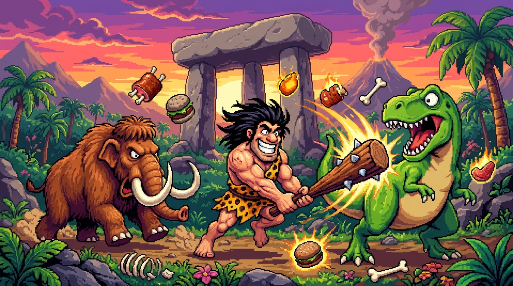
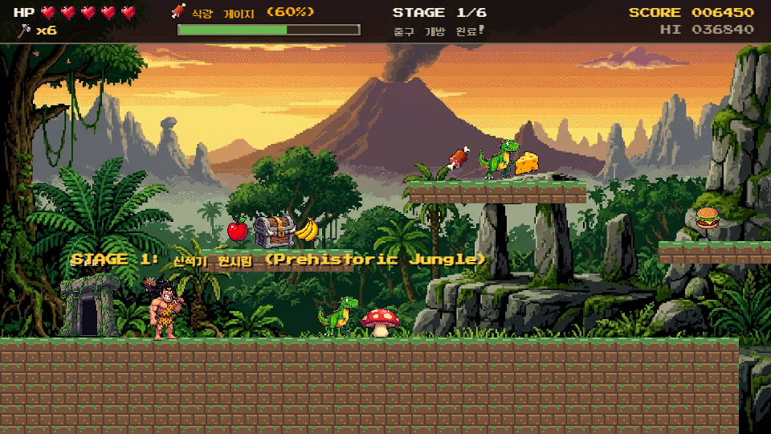
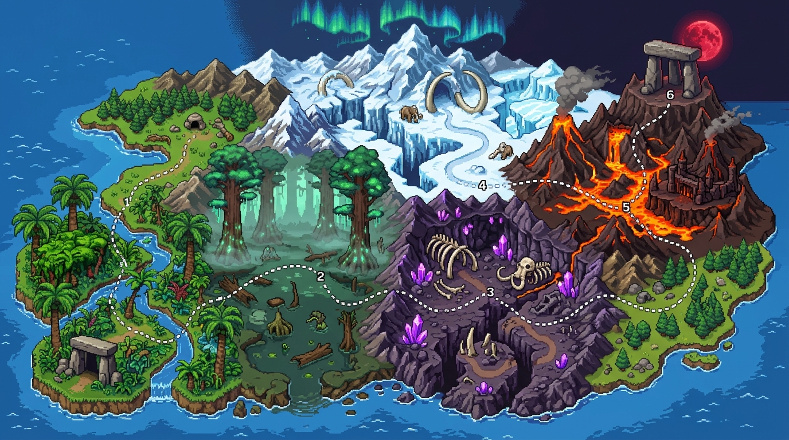

<div align="center">

# 🪨 고인돌 (GOINDOL : Prehistorik Web Arcade)

**추억의 1991/1993년 DOS 명작 원시인 액션 플랫포머 《고인돌 (Prehistorik)》 웹 아케이드 6대 스테이지 확장판**  
외부 라이브러리 없이 **HTML5 Canvas 16비트 픽셀 아트, 6종 테마 배경과 Web Audio API 칩튠 신디사이저**로 구현한 브라우저 즉시 실행 게임 & 랜딩 페이지입니다.

[](https://jeiel85.github.io/goindol/)
[](https://developer.mozilla.org/en-US/docs/Web/API/Canvas_API)
[](https://developer.mozilla.org/en-US/docs/Web/API/Web_Audio_API)
[]()

<br />



<br />



<br />

👉 **[라이브 데모 바로 플레이하기 (https://jeiel85.github.io/goindol/)](https://jeiel85.github.io/goindol/)** 👈

</div>

---

## ✨ 주요 특징 (Key Features)

- **🗺️ 대폭 확장된 6대 원시 월드 캠페인 (6 Full Prehistoric Worlds)**
  - 원시림·거대 늪지대·화산 동굴·빙하기 설원·용암 화구 성채·대고인돌 제단까지 총 **6개의 개성 넘치는 바이옴과 전용 16비트 픽셀아트 배경/타일셋**을 수록했습니다.
- **🪨 이동식 발판 & 중간 세이브 고인돌 (Moving Bridges & Checkpoint Dolmens)**
  - 넓은 협곡과 용암 강을 가로지르는 **수평·수직 이동 발판**과 스테이지 중반의 **CHECKPOINT 고인돌(중간 세이브)**이 추가되어 더욱 입체적인 플랫포밍을 즐길 수 있습니다.
- **🔨 찰진 몽둥이 타격감 & 비밀 식량 폭포 (Club Smash & Secret Food Caches)**
  - 원시인 **샘(Sam)**의 참나무 몽둥이로 지면을 내리칠 때 발생하는 묵직한 타격음과 화면 진동(Screen Shake), 그리고 **뼈 문양 토템 바위**를 두드려 숨겨진 고기·햄버거·아이스크림·돌도끼를 쏟아내는 원작의 시그니처 기믹을 재현했습니다.
- **📊 식량 게이지 & 고인돌 관문 시스템 (Food Gauge & Dolmen Exit)**
  - 음식을 수집해 상단 **식량 게이지(Food Gauge)를 50% 이상** 채워야 스테이지 마지막의 **고인돌 관문(`★ EXIT OPEN ★`)**이 열립니다.
- **🎵 무에셋 Web Audio API 6종 테마 사운드트랙**
  - 외부 MP3/WAV 파일 없이 `AudioContext` 오실레이터와 노이즈 필터만으로 **6개 스테이지 전용 배경음악(BGM)**과 11종의 레트로 효과음을 실시간 합성합니다.

---

## 🎮 조작법 (Controls)

| 동작 | 키보드 (주 키) | 키보드 (보조 키) | 모바일 / 태블릿 |
| :--- | :---: | :---: | :---: |
| **좌우 이동** | `←` / `→` 방향키 | `A` / `D` | 좌측 `◀` `▶` 터치 버튼 |
| **점프** | `Space` | `Z` / `↑` / `W` | 우측 `JUMP` 버튼 |
| **몽둥이 내려치기** | `X` | `J` / `Enter` | 우측 `몽둥이` 버튼 |
| **돌도끼 던지기** | `C` | `K` | 우측 `AXE` 버튼 |
| **일시정지** | `P` | `Esc` | 상단 컨트롤 바 |

---

## 🗺️ 6대 스테이지 구성 (6-Stage Campaign & Bosses)

<div align="center">
  
</div>

<br />

1. **🌲 STAGE 1: 신석기 원시림 (Prehistoric Jungle)**
   - 거대 고사리 나무와 고인돌 유적이 펼쳐진 입문 스테이지. 통통 버섯과 통나무 뗏목 다리를 건너며 숨겨진 바위 보물을 찾아내세요.
2. **🍄 STAGE 2: 거대 고목 늪지대 (Ancient Swamp & Marsh)**
   - 발광 버섯과 수몰된 고인돌이 빛나는 신비로운 늪지대. 늪을 배회하는 **늪지 악어(Swamp Gator)**와 보라 익룡 편대의 공중 습격을 돌파하고 특산 식량 **원시 연어**를 수집하세요.
3. **🌋 STAGE 3: 화산 동굴과 공룡 협곡 (Volcanic Cave & Bone Canyon)**
   - 지하 종유석과 용암 균열이 흐르는 동굴 지형. 수직 흑요석 승강기 발판을 타고 동굴 상층부의 비밀 토템과 **황금 호박 보석(+800점)**을 공략하세요.
4. **❄️ STAGE 4: 빙하기 설원 협곡 (Ice Age Glacial Gorge - 중간 보스전)**
   - 오로라가 빛나는 설원 협곡과 얼음 결정 유빙 브릿지! 초고속으로 질주하는 **빙하 검치호(Sabertooth)**를 돌파하면 중간 보스 **빙하 설원 수호자(Frost Mammoth, HP 14)**가 얼음 바위 충격파로 관문을 지킵니다.
5. **🔥 STAGE 5: 용암 화구 성채 (Magma Caldera Fortress)**
   - 끓어오르는 화산 칼데라 성채! 용암 강 위의 마그마 부유석과 체력이 강화된 **용암 갑옷 공룡(Magma Rex, HP 3)**들을 뚫고 특산 식량 **화산 통구이**를 챙겨 정상으로 진격하세요.
6. **🦣 STAGE 6: 대고인돌 제단 - 거대 맘모스 대왕 최종 결전 (Final Boss Arena)**
   - 붉은 블러드문 아래 펼쳐지는 최종 결전! 상공의 이동 발판과 버섯 점프대를 활용해 **거대 맘모스 대왕(HP 24)**의 대지 충격파와 분노 모드를 물리치고 황금 고기를 쟁취하세요!

---

## 🏗️ 프로젝트 구조 (Project Structure)

```text
goindol/
├── index.html             # 아케이드 캐비닛 라이브 데모 & 6대 월드맵/도감 랜딩 페이지
├── css/
│   └── style.css          # 레트로 아케이드 테마, 6종 스테이지 카드, CRT 필터, 반응형 터치 UI
├── js/
│   ├── audio.js           # Web Audio API 기반 6종 스테이지 전용 BGM 시퀀서 & 효과음 합성기
│   ├── pixel_assets.js    # 16비트 픽셀 스프라이트·아이콘·6종 바이옴 타일 생성 및 배경 로딩
│   ├── sprites.js         # 패럴랙스 배경과 픽셀 스프라이트 Canvas 렌더러
│   ├── levels.js          # 스테이지 1~6 지형, 이동 발판, 체크포인트, 비밀 토템, 보스 데이터
│   └── game.js            # 60FPS 물리 엔진, 이동 발판 동기화, 체크포인트 부활, 보스 AI, HUD
└── assets/
    ├── bg_jungle.png      # 스테이지 1 신석기 원시림 배경
    ├── bg_swamp.png       # 스테이지 2 거대 고목 늪지대 배경
    ├── bg_cave.png        # 스테이지 3 화산 동굴 협곡 배경
    ├── bg_ice.png         # 스테이지 4 빙하기 설원 협곡 배경
    ├── bg_volcano.png     # 스테이지 5 용암 화구 성채 배경
    ├── bg_boss.png        # 스테이지 6 대고인돌 제단 보스 아레나 배경
    ├── sam_idle_run.png   # 주인공 원시인 샘(Sam) 대기/질주/점프 16비트 스프라이트 시트
    ├── sam_attack.png     # 주인공 원시인 샘(Sam) 몽둥이 차징/강타 16비트 스프라이트 시트
    ├── monsters_sheet.png # 6종 원시 몬스터(랩터/멧돼지/익룡/악어/검치호/용암렉스) 16비트 시트
    ├── bosses_sheet.png   # 2종 거대 보스(빙하 설원 수호자 / 거대 맘모스 대왕) 16비트 시트
    ├── items_sheet.png    # 11종 식량·보물·돌도끼·생명 하트 16비트 아이콘 시트
    ├── dolmens_sheet.png  # 4종 고인돌 관문(시작문/체크포인트 성소/닫힌 출구/열린 차원문) 16비트 시트
    ├── props_sheet.png    # 점프 버섯 & 3단계 타격 원시 보물상자 16비트 오브젝트 시트
    ├── world_map.png      # 6대 스테이지 선사시대 대륙 파노라마 월드맵
    ├── hero_banner.png    # 타이틀 & 랜딩 페이지 아케이드 키 아트
    └── gameplay_preview.png # 인게임 플레이 프리뷰 스크린샷
```

---

## 🚀 로컬 실행 방법 (Quick Start)

별도의 빌드 도구나 패키지 설치가 필요하지 않습니다.

```bash
# 저장소 클론
git clone https://github.com/jeiel85/goindol.git
cd goindol

# 브라우저에서 index.html 바로 열기 (또는 로컬 정적 서버 실행)
npx serve .
```

---

## 📜 라이선스 (License)

This project is licensed under the **MIT License**.  
Inspired by the classic 1991/1993 DOS game *Prehistorik* by Titus Interactive.
